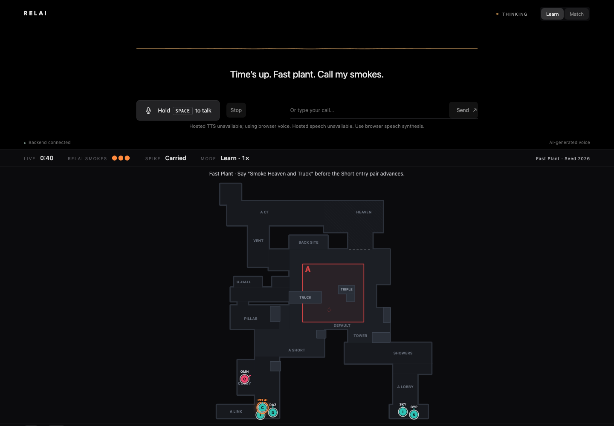

<h1 align="center">RelAI</h1>

<p align="center"><b>A voice teammate that only acts on clear callouts, and only calls out what it can actually see.</b><br>
RelAI (say "relay") is the comms layer for a game bot. You shot-call a top-down Bind A attack out loud. RelAI turns clear calls into validated actions, pushes back on vague ones ("Smoke where?"), and makes its own callouts only from enemies it has really seen.</p>

<p align="center">
  
  
  
  
  
  
  
</p>

<p align="center"></p>

<p align="center">Built by <a href="https://github.com/StevenGantumur">Steven Gantumur</a> and <a href="https://github.com/Adit2020">Aditya</a> for DevHacks '26, Riot Track 1: Gameplay Bots.<br>
<sub>RelAI isn't endorsed by Riot Games and doesn't reflect the views or opinions of Riot Games or anyone officially involved in producing or managing Riot Games properties. Riot Games and all associated properties are trademarks or registered trademarks of Riot Games, Inc. No Riot art or audio is used: icons are drawn in code, every line is our own, and the voice is a stock TTS voice.</sub></p>

## Why this exists

Riot and others are building bots that move and fight like people. None of them can be talked to. Counter-Strike bots still take orders from a fixed radio menu, and the most advanced public AI teammate (PUBG Ally) scored 2.58/5 for combat, with only 18.5% of players seeing it as a real teammate.

Real comms look nothing like a radio menu. Counter-Strike tournament players make about 16 callouts a minute, most of them 8 words or fewer, 69.5% of callouts about yourself or the enemy include a location, and the information goes stale within seconds. RelAI is built around those numbers. Our 2D sim stands in for Valorant, and our rule-based bot stands in for Riot's. Sources are in [`RESEARCH.md`](RESEARCH.md).

## How it works

1. **Call the play.** During the 15-second buy phase, say "Fast plant", "Rush Showers" or "Take it slow", or click a play.
2. **Talk.** Hold Space. Chrome's speech recognition finalizes the transcript when you let go.
3. **Understand.** A keyword matcher handles common calls in well under a millisecond. Messy speech goes to a small LLM with a 2-second limit, and the model may only return structured `Action`s.
4. **Validate.** Zod checks the shape, then a validator checks the game: the right site, a named target, charges left, a reachable spot. The model's targets must match the places named in the transcript. Anything that fails gets a short pushback instead of an action.
5. **Act.** A 20 Hz fast layer (A\*, line of sight, a goal queue) carries the action out. It never waits on the LLM.
6. **Call back.** RelAI's own callouts ("One Heaven.") are templates filled from its real sightings, and each one is linked to that sighting in the trace.

## Calls decide the round

Defenders standing still and already aimed fire first, so walking into an unsmoked angle loses the duel. RelAI never throws utility on its own. If nobody calls the smokes, nobody gets them.

Fast plant, seeds 1–40, with the call made as the round starts:

| What the player says | Rounds won |
|---|---|
| Nothing | **0 / 40** (0%) |
| "Smoke Heaven and Truck" | **29 / 40** (73%) |

The losses that remain depend on where Omen spawns. Timing matters too: on seed 2026 the call wins if it lands within 5 seconds of the round going live and loses from 6 seconds on. By 7 seconds RelAI is already dead.

## It pushes back instead of guessing

A teammate that says "okay" and does the wrong thing is worse than one that asks. These replies come from running each line through the live pipeline with a fake model that obediently returns "smoke Heaven" for anything it's asked:

| You say | RelAI says | What reaches the game |
|---|---|---|
| "Smoke over there" | Smoke where? | Nothing |
| "Smoke B long" | That's B. We're on A. | Nothing |
| "Molly them" | Which target? | Nothing |
| "Smoke Heaven, smoke Vent, smoke U-Hall, smoke Tower" | Out of smokes. | Nothing (3 charges) |
| "Throw infinite smokes" | Give me one clear call. | Nothing |
| "What's the score" (model invents "smoke Heaven") | Which targets, in order? | Nothing |
| "Smoke Heaven" | Will smoke Heaven. | One smoke |

## Measured against a plain bot

The comparison bot (`?bot=plain`) works the way Counter-Strike bots and PUBG Ally do: it says "Copy." to everything, never pushes back, and carries out whatever it parsed. Everything below comes from `npm run evidence`:

| Metric | Result |
|---|---|
| Trick inputs that put an action into the game | RelAI **0 / 15** · plain bot **3 / 15** (6 actions) |
| Messy phrasings understood, keyword matcher only | **23 / 30**. The other 6 go to the LLM, which wasn't measured (no API key) |
| RelAI callouts traced to a real sighting | **247 / 247**, over 150 simulated rounds, each checked against the true defender positions |

How far to trust each number:
- **Trick inputs:** they use a fake model that is obedient and wrong on purpose, which is the failure we care about.
- **Parser:** it covers the keyword matcher alone. The LLM column needs a key.
- **Grounding:** it comes from a simulation sweep, not live play.
- **Human study:** the tooling is built (see [`docs/STUDY.md`](docs/STUDY.md)), but no human sessions have been run yet. There is no transfer result to report.

## When something fails, it says so

| Failure | What the player sees |
|---|---|
| LLM takes longer than 2 s | "Say again?" The keyword path keeps working |
| Model returns something invalid | "Didn't catch that." Nothing is executed |
| Model's targets don't match what you said | "Which targets, in order?" |
| RelAI makes no movement progress for 3 s, or fails twice | It drops the stale goals and falls back to the scripted route |
| RelAI is dead or the round is over | "RelAI is down." / "Round is not live." |

## What broke along the way

**Silence used to win.** Before the round rules changed, Fast plant won 36 of 50 seeds with no calls at all. The plays threw their own smokes, so the player's voice didn't matter. Now plays throw nothing on their own, defenders holding an angle fire first, and silence wins 0 of 40.

**Speech recognition can't spell RelAI.** Chrome hears it as "relay", "real AI" or "rely", so "relay, smoke Heaven" used to fall through to the LLM. The keyword matcher now strips all of them (and the old name) from the front of a call.

**TTS read the name as letters.** The audio now says "Relay" while the subtitle keeps "RelAI". The two words are the same length, so word highlighting still lines up with the voice.

**One check wasn't enough.** A fake model that replies "Okay." is stopped by the response schema before anything else runs. A fake that returns a schema-valid wrong action got past that, so there's a second check: the model's targets must be exactly the places the player named, in order.

## Known issues

- **Fast plant only.** Fast rush jams if smokes are called in its first second, and Slow push isn't tuned for the current round rules. Use Fast plant for sessions and the demo.
- **Chrome only.** Speech recognition uses Chrome's Web Speech API and usually needs a network connection.
- **Live latency is unmeasured.** Without an API key, LLM and hosted TTS timings with real providers haven't been measured.
- **Small world.** One site (Bind A), attack side only, scripted defenders, no teleporters.

## System design

```
┌───────────────┐ transcript ┌──────────────────┐  no match   ┌──────────────────┐
│  Mic + Chrome │ ─────────> │ keyword matcher  │ ──────────> │ POST /api/brim   │
│  Web Speech   │            │ aliases, < 1 ms  │             │ OpenAI, 2 s cap  │
└───────────────┘            └────────┬─────────┘             └────────┬─────────┘
                                      │ Actions                        │ Actions
                                      v                                v
                             ┌───────────────────────────────────────────────────┐
                             │ Zod + validator: site, target, charges, reach,    │
                             │ model targets = named targets  ──fail──> pushback │
                             └────────────────────────┬──────────────────────────┘
                                                      │ goals
                                                      v
┌───────────────┐  sightings ┌──────────────────┐            ┌──────────────────┐
│ callout gen   │ <───────── │ 20 Hz round      │ ─────────> │ Canvas map       │
│ "One Heaven." │            │ A*, LOS, combat, │   state    │ 60 fps, HUD      │
└───────┬───────┘            │ goal queue       │            └──────────────────┘
        │ line               └────────┬─────────┘
        v                             │ every turn and event
┌───────────────┐                     v
│ TTS: /api/tts │            ┌──────────────────┐
│ or browser    │            │ trace JSON v3    │
└───────────────┘            └──────────────────┘
```

The LLM never moves anything. It can only propose `Action`s, which go through the same validator as the keyword path. API keys stay on the server, and the map and effects run on sim time, so a seed replays the same round every time.

## Stack

| What | How |
|---|---|
| Language | TypeScript, strict |
| Frontend | Vite 7, Canvas 2D (20 Hz sim, 60 fps render), plain HTML and CSS |
| Voice in | Chrome Web Speech API, push-to-talk on Space |
| Voice out | OpenAI TTS, streamed (`gpt-4o-mini-tts`), with a browser `speechSynthesis` fallback |
| Language model | OpenAI Responses structured output (`gpt-4.1-mini`), optional |
| API | Node, Express 5 |
| Contracts | Zod 4, shared between browser and server in `shared/schema.ts` |
| Tests | `node:test` through `tsx` |

## Run it

Needs Node 22.12+ and desktop Chrome.

```sh
git clone https://github.com/Adit2020/valorant-bot.git
cd valorant-bot
npm install
npm run dev      # API on 127.0.0.1:3001, app on http://127.0.0.1:5184
```

No API key is needed. Without one, the keyword path, pushback, callouts and the browser voice all work. For the LLM path and hosted voice, copy `.env.example` to `server/.env`, set `OPENAI_API_KEY`, and restart. The key stays on the server.

| Command | What it does |
|---|---|
| `npm run dev` | API and app, with reload |
| `npm test` | 135 tests: contracts, API, voice, comms, map, sim, trace and study |
| `npm run typecheck` | Browser, server, shared contracts, tools and tests |
| `npm run build` | Production frontend in `web/dist/` and backend in `dist/server/` |
| `npm run evidence` | Trick inputs, parser comparison, grounding sweep and speed |
| `npm run score -- trace.json` | Call scores for a downloaded trace |
| `npm run study -- sessions/human` | Paired report for the human study |

## Use it

Open **http://127.0.0.1:5184/?seed=2026** in Chrome. To win that round:

1. Pick **Fast plant**: say it, type it, or click it.
2. Press **P** to pause, so there's time to talk.
3. Hold **Space**, say **"Smoke Heaven and Truck"**, and let go. RelAI answers "Command accepted."
4. Press **P** again. RelAI smokes both angles, Sova plants at Default, and the round ends **won** when the timer runs out.

Then try "Smoke over there" or "Smoke B long" to hear the pushback. Use **R** to restart the same seed, **L** to switch between Learn (the round runs at half speed while you hold Space) and Match, and **D** for designer view, which shows every defender. **Download trace** saves every turn and every RelAI event as JSON.

| URL | What changes |
|---|---|
| `/?seed=N` | Plays seed N. The same seed replays the same round |
| `/?seed=2026&bot=plain` | The plain comparison bot: "Copy." to everything |
| `/?participant=P01&group=T&phase=pre` | Human study mode. See [`docs/STUDY.md`](docs/STUDY.md) |

More detail:
- [`docs/DEMO.md`](docs/DEMO.md): the demo runbook.
- [`web/src/trace/README.md`](web/src/trace/README.md): how to read a trace.
- [`web/src/comms/README.md`](web/src/comms/README.md): the command pipeline.
- [`web/src/sim/README.md`](web/src/sim/README.md): the simulation.
- [`web/src/map/README.md`](web/src/map/README.md): the map.
